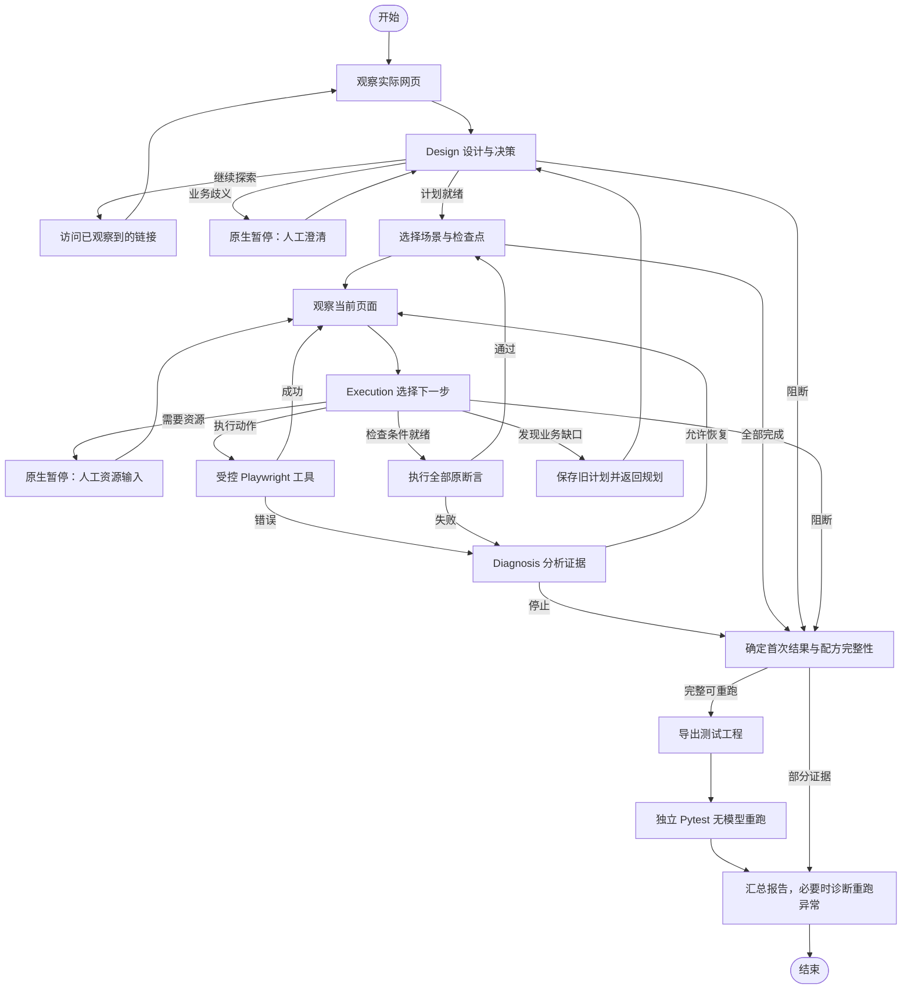

# 通用三 Agent 网页端到端测试

基于 **LangChain + LangGraph + Playwright + Pytest** 的命令行测试应用。输入一个网页地址和自然语言测试目标，程序通过三个 Agent 完成页面探索、需求澄清、测试规划、浏览器操作和失败诊断，并在证据完整时导出可独立重跑的测试工程。

例如，你可以提出：“查询我的订单，确认状态是‘已发货’。”程序观察实际页面，制定带有明确预期的检查点，在执行时请求订单号，操作浏览器，并使用真实断言判断结果。完成后，它还会启动独立 Pytest 进程，使用保存的动作配方重新验证。

当前新任务统一进入 `e2e_agent/core/` 通用核心。网站、业务资源名称和操作顺序由 Agent 根据目标及页面决定；代码负责结构校验、工具边界、资源隔离、预算和实际验收。项目内的登录、订单、订阅和商城页面用于演示与评测。

> 本文以当前源码为准。Windows PowerShell 是下文的主要运行环境；项目版本为 `0.1.0`。历史开发文档、旧运行记录与 `legacy/` 的适用范围见[文档导航](#文档导航)。

## 目录

- [项目能做什么](#项目能做什么)
- [环境要求与依赖](#环境要求与依赖)
- [安装与初始化](#安装与初始化)
- [模型与运行配置](#模型与运行配置)
- [快速开始](#快速开始)
- [本地示例与完整交互](#本地示例与完整交互)
- [如何编写测试需求](#如何编写测试需求)
- [命令行参考](#命令行参考)
- [三个 Agent 与执行流程](#三个-agent-与执行流程)
- [计划、断言与浏览器能力](#计划断言与浏览器能力)
- [人工资源与数据处理](#人工资源与数据处理)
- [运行产物与报告](#运行产物与报告)
- [重跑、重新执行与单独诊断](#重跑重新执行与单独诊断)
- [项目结构与扩展方式](#项目结构与扩展方式)
- [测试与验证](#测试与验证)
- [常见问题](#常见问题)
- [能力边界](#能力边界)
- [文档导航](#文档导航)
- [来源与许可证](#来源与许可证)

## 项目能做什么

| 能力 | 当前行为 |
| --- | --- |
| 自然语言测试 | 接受 HTTP(S) 地址及中文或英文测试目标，先观察页面，再设计场景和检查点 |
| 需求澄清 | 发现影响验收的业务歧义时询问用户；明确目标可以直接规划 |
| 逐步执行 | 根据当前页面选择一次浏览器操作，操作后重新观察 |
| 人工资源输入 | 执行到需要账号、密码、订单号、邮箱、验证码等位置时，再请求相应字符串 |
| 真实断言 | 使用 Playwright 验证文本、输入值、可见性、数量、URL 等条件 |
| 失败诊断 | 区分执行问题、疑似产品问题、环境问题、需求缺口及无法确定的原因，并引用已有证据 |
| 有限恢复 | 仅在程序确认动作尚未发出等条件下允许恢复，保留原始失败 |
| 工程导出 | 证据和配方完整时，生成测试入口、最终计划与最小重跑支持代码 |
| 无模型重跑 | 使用独立 Pytest 进程执行保存的动作及原断言，重新请求资源 |
| 证据报告 | 保留首次执行、独立重跑、诊断、未执行检查与结果不一致信息 |

适合体验 Agent 浏览器测试、验证可重复的表单流程、研究人工参与的执行与证据闭环。目前主要覆盖同一 origin 内的普通 DOM 页面、表单和导航；具体限制见[能力边界](#能力边界)。

## 环境要求与依赖

- **Python：** `>=3.11,<3.14`；项目安装脚本采用 `.python-version` 指定的 **3.13.13**。
- **安装工具：** 使用 `setup.ps1` 时，需要预先安装并能找到 `uv`。
- **浏览器：** Playwright 管理的 Chromium，项目默认安装在 `.browsers/`。
- **网络：** 首次安装需要下载 Python、依赖与 Chromium；真实 Agent 任务还需要连接配置的模型服务和目标网站。
- **控制台：** 建议使用 PowerShell / Windows Terminal，以支持资源的隐藏输入。
- **模型密钥：** 运行真实 Agent 任务至少配置 DeepSeek 或千问之一；环境检查、本地站点服务、无模型教学示例及导出重跑不需要模型密钥。

主要依赖及其用途：

| 组件 | 声明版本 | 用途 |
| --- | --- | --- |
| LangGraph | `0.2.18` | 图状态、节点路由、原生暂停与内存检查点 |
| LangGraph Checkpoint | `1.0.9` | 检查点支持 |
| LangChain Core | `0.3.86` | 消息与模型调用基础接口 |
| LangChain OpenAI | `0.3.35` | 通过 `ChatOpenAI` 调用兼容接口 |
| Pydantic | `2.14.1` | 计划、动作、断言和 Agent 输出校验 |
| Playwright | `>=1.50,<2` | Chromium 自动化与实际断言 |
| Pytest | `>=8,<10` | 项目测试及独立重跑 |
| Flask | `>=3.1,<4` | 独立本地测试站 |
| python-dotenv | `1.2.4` | 读取本地 `.env` |
| typing-extensions | `4.16.0` | 类型支持 |

依赖声明见 [pyproject.toml](pyproject.toml)，可复现安装使用 [uv.lock](uv.lock)。表中的范围是声明约束，具体解析版本以锁文件为准。

## 安装与初始化

### 1. 已有环境：直接检查

如果目录中已经有可用的 `.venv`、`.browsers` 和 `.env`，先运行检查，无需重新安装或覆盖配置：

```powershell
cd E:\e2e_testing_agent
.\.venv\Scripts\python.exe main.py check --browser
```

`check` 显示项目路径、实际解释器和模型是否已配置；`--browser` 额外启动并关闭 Chromium。它不会调用模型，也不会验证密钥是否有效、账户额度或目标网站是否可达。

### 2. 首次安装：使用项目脚本

确认 `uv` 可用后，在 PowerShell 执行：

```powershell
cd E:\e2e_testing_agent
uv --version
.\setup.ps1
```

[setup.ps1](setup.ps1) 会执行以下步骤：

1. 按 `.python-version` 下载项目专用 Python 到 `.python-runtime/`。
2. 按 `uv.lock` 同步依赖到 `.venv/`，检查依赖一致性。
3. 下载 Chromium 到 `.browsers/`，使用 `--no-shell` 安装方式。
4. 运行 `check --browser`，确认项目浏览器能够启动。

脚本临时设置安装路径，结束后恢复原进程中的相关环境变量；它不会创建或覆盖 `.env`。如果系统执行策略拦截脚本，可在符合本机管理要求的情况下，仅为这一次调用指定策略：

```powershell
powershell -NoProfile -ExecutionPolicy Bypass -File .\setup.ps1
```

### 3. 创建本地配置

仅在 `.env` 尚不存在时复制示例：

```powershell
if (-not (Test-Path -LiteralPath .env)) {
    Copy-Item -LiteralPath .env.example -Destination .env
}
notepad .env
```

填入自己的模型密钥后保存。`.env`、运行产物和本地环境目录已列入 [.gitignore](.gitignore)。

### 4. 在 PyCharm 中运行

将解释器设置为：

```text
E:\e2e_testing_agent\.venv\Scripts\python.exe
```

运行文件选择 `main.py`，工作目录设置为项目根目录，参数可以填写 `check --browser` 或完整的 `run ...` 命令参数。项目已有 `E2E Agent` 运行配置，默认参数为 `--headed`，会进入交互式输入。

部分 IDE 控制台能读取普通文本，但无法完成隐藏输入。使用本文的虚构示例数据时，可以加 `--visible-input`；真实敏感资源应在支持隐藏输入的终端中提供。控制台输入说明见[人工资源与数据处理](#人工资源与数据处理)。

## 模型与运行配置

程序默认读取项目根目录 `.env`，也可以通过 `--env-file` 指定其他文件。**同名进程环境变量优先于配置文件**，包括被设置为空字符串的环境变量。

最小配置是在 `.env` 中填写以下任意一个密钥：

```dotenv
DEEPSEEK_API_KEY=填写你的密钥
# 或者填写 QWEN_API_KEY
```

完整变量说明：

| 变量 | 默认值 | 说明 |
| --- | --- | --- |
| `DEEPSEEK_API_KEY` | 空 | DeepSeek 密钥；配置后优先使用 |
| `DEEPSEEK_BASE_URL` | `https://api.deepseek.com` | DeepSeek 兼容接口地址 |
| `DEEPSEEK_MODEL` | `deepseek-chat` | DeepSeek 模型标识 |
| `QWEN_API_KEY` | 空 | 千问密钥；可单独使用，也可作为备用 |
| `QWEN_BASE_URL` | `https://dashscope.aliyuncs.com/compatible-mode/v1` | 千问兼容接口地址 |
| `QWEN_MODEL` | `qwen-plus` | 千问模型标识 |
| `REQUEST_TIMEOUT` | `60` | 单次模型请求超时，单位秒 |
| `ACTION_TIMEOUT_MS` | `10000` | 页面导航和多数工具动作的超时，单位毫秒 |
| `WORKER_TIMEOUT` | `45` | 保留给历史执行进程的超时配置，单位秒；通用核心不使用旧 worker 主流程 |
| `REPLAY_TIMEOUT` | `120` | 主流程及 CLI `replay` 的独立重跑活动时间预算，单位秒 |
| `MAX_ACTIONS` | `16` | 通用流程动作预算，必须是 `1` 到 `40` 的整数 |
| `HEADLESS` | `true` | 是否隐藏浏览器；接受 `true/false/1/0`，`--headed` 可覆盖为显示浏览器 |

所有超时配置必须是有限正数。页面断言当前使用工具内部的约 2 秒等待，并非统一采用 `ACTION_TIMEOUT_MS`。

如果两个供应商都配置了密钥，模型网关按 **DeepSeek → Qwen** 顺序尝试；结构校验失败时可在预算内纠正一次，供应商请求失败后尝试下一个已配置供应商。三个 Agent 共用这套供应商配置，备用切换不增加新的业务角色。接口连通性不等于结构化输出兼容：Execution 使用 `function_calling`，Design 和 Diagnosis 使用 `json_mode`。

指定其他配置文件：

```powershell
.\.venv\Scripts\python.exe main.py check --env-file .env.testing --browser
```

未显式配置时，程序为 LangSmith / LangChain tracing 设置关闭默认值；已有 tracing 环境变量不会被强制覆盖。

## 快速开始

### 不调用模型：验证教学示例

```powershell
cd E:\e2e_testing_agent
.\.venv\Scripts\python.exe main.py demo --headed
```

`demo` 使用保留的固定注册教学流程，自动启动本地样例页面，执行并重跑测试。它适合确认浏览器与测试链路可用；它不验证通用三 Agent 的模型决策能力，也不接受自定义 `--url` 或 `--query`。

### 调用模型：运行一个明确目标

先完成模型配置，再执行：

```powershell
.\.venv\Scripts\python.exe main.py run --url "https://the-internet.herokuapp.com/inputs" --query "在数字输入框中填写7，并确认输入框的值为7。" --headed
```

这是依赖公网可用性的示例。命令结束后，控制台会打印最终状态与 `report.html` 的路径。若公共网站不可达，可以使用下一节的本地测试站。

### 交互式启动

```powershell
.\.venv\Scripts\python.exe main.py --headed
```

不指定命令时默认执行 `run`。程序询问测试网址；直接回车会启动独立本地测试环境，然后询问测试需求。也可以使用 Windows 启动器 `run.bat`，它会转到项目目录并调用项目解释器，结束后暂停窗口。

## 本地示例与完整交互

### 启动独立测试站

在第一个 PowerShell 终端执行：

```powershell
cd E:\e2e_testing_agent
.\.venv\Scripts\python.exe main.py serve --port 8765
```

该命令只启动本地 Flask 测试站，不调用模型。保持此终端运行，在第二个终端执行测试。按 `Ctrl+C` 停止服务。

| 路径 | 业务 | 体验重点 |
| --- | --- | --- |
| `/` | 测试站入口 | 查看各业务链接 |
| `/identity` | 选择密码或邮箱验证码登录 | 模型如何判断登录范围需要澄清 |
| `/identity/password` | 密码登录 | 执行时请求账号、密码 |
| `/identity/email-code` | 邮箱验证码登录 | 邮箱和一次性验证码的输入 |
| `/orders` | 订单查询 | 订单号作为资源，不作为业务澄清 |
| `/newsletter` | 邮箱订阅 | 相同资源协议用于另一种业务 |

### 示例一：模糊需求触发业务澄清

```powershell
.\.venv\Scripts\python.exe main.py run --url "http://127.0.0.1:8765/identity" --query "测试登录功能。" --headed
```

页面提供两种登录方式，需求未指定覆盖范围。预期由 Design Agent 根据实际观察识别歧义；可以回答：“只覆盖密码登录成功，登录后应显示个人中心。”随后在资源提示出现时提供账号 `demo-user` 和密码 `demo-password`。

提问的措辞、探索顺序及具体计划由模型决定，并非匹配这句需求的固定脚本。

### 示例二：明确需求直接执行

```powershell
.\.venv\Scripts\python.exe main.py run --url "http://127.0.0.1:8765/orders" --query "查询我的订单，确认状态是‘已发货’。" --headed
```

订单号可输入 `ORDER-TEST-001`。这一需求已经给出业务预期，缺少订单号应通过资源通道处理。演示站提交订单后固定返回“已发货”，用于测试流程机制，不实现真实订单数据库。

### 示例三：更换业务资源

```powershell
.\.venv\Scripts\python.exe main.py run --url "http://127.0.0.1:8765/newsletter" --query "订阅周刊，提交后应显示‘订阅成功’。" --headed
```

邮箱可输入 `fictional@example.test`。登录、订单和订阅共享同一通用引擎，不需要为资源名称增加核心枚举。

### 示例四：邮箱验证码

```powershell
.\.venv\Scripts\python.exe main.py run --url "http://127.0.0.1:8765/identity/email-code" --query "使用邮箱验证码登录，登录成功后应显示‘个人中心’。" --headed
```

邮箱使用虚构地址。Agent 点击获取验证码后，在**运行 `serve` 的终端**查看模拟验证码，并在资源提示中输入。测试站不会发送真实邮件；模拟实现见 [demo_sites.py](e2e_agent/demo_sites.py)。执行器通过页面和人工输入工作，不读取测试站的隐藏数据。

### 输入时需要知道的事

- 普通业务澄清使用可见文本，回车提交。
- 敏感资源默认隐藏输入，键入时可能看不到字符，这是正常行为。
- 输入 `:cancel` 可取消当前请求；缺少必要回答或资源时会阻断或取消任务。
- 完整首轮执行后会自动独立重跑，**可能再次请求相同资源**。这是新进程、新浏览器的验证，需要重新提供输入。
- 本地示例中的账号、密码、订单号和邮箱均是虚构数据。IDE 中只能使用普通输入时，可在命令末尾加 `--visible-input`。

例如，在不支持隐藏输入的控制台体验订单示例：

```powershell
.\.venv\Scripts\python.exe main.py run --url "http://127.0.0.1:8765/orders" --query "查询我的订单，确认状态为已发货。" --headed --visible-input
```

## 如何编写测试需求

一个容易验收的目标应说明：**测试哪条业务、覆盖什么条件、预期看到什么结果**。尽量描述业务结果，页面定位由 Agent 完成。

| 需求 | 可能的处理方式 |
| --- | --- |
| “测试登录功能。” | 页面若有多个合理流程，需要澄清范围与预期 |
| “只测试密码登录成功，使用有效账号登录后应显示‘个人中心’。” | 范围和结果明确；执行时请求凭据 |
| “查询我的订单，确认状态是‘已发货’。” | 预期明确；执行时请求订单号 |
| “提交后应该成功。” | 若页面和上下文无法解释“成功”，需要进一步确认 |

业务预期可以来自用户目标、确认的业务回答，或网页明确公布的规则。网站当前显示了某个结果，并不能单独证明该结果正确。账号、密码、订单号、临时验证码等用户资源应留到资源提示时提供，避免写进 `--query` 或业务澄清答案。

执行期间若发现新的业务歧义，Execution 可以返回 Design 修订计划。修订会保留旧版本，不能删除或弱化已经确认的要求及断言。

## 命令行参考

```text
python main.py [command] [run_dir] [options]
```

也可以从项目目录使用 `python -m e2e_agent`；下表中的 `python` 应替换为项目 `.venv` 解释器。所有参数由同一解析器接收，但其作用范围如下。

### 命令

| 命令 | 作用 | 需要模型 |
| --- | --- | --- |
| `run` | 运行通用三 Agent；默认命令 | 是 |
| `demo` | 固定注册教学示例，使用历史实现 | 否 |
| `check` | 读取并检查配置；可选启动浏览器 | 否 |
| `serve` | 启动独立本地测试站 | 否 |
| `replay <run_dir>` | 重跑已有完整导出工程；也兼容历史记录 | 否 |
| `resume <run_dir>` | 使用原记录中已确认的计划，从起点创建新任务 | 是 |
| `diagnose <run_dir>` | 分析已保存的失败证据，在新子目录保存诊断 | 是 |

### 参数

| 参数 | 作用与适用范围 |
| --- | --- |
| `--url URL` | `run` 的完整 HTTP(S) 网址；使用时必须同时提供 `--query` |
| `--query TEXT` | 自然语言测试需求；缺省时，交互式入口会询问 |
| `--env-file PATH` | 替换默认配置文件，文件必须存在 |
| `--headed` | 新浏览器使用有界面模式；独立重跑的模式由导出清单保存 |
| `--visible-input` | 允许资源以普通文本输入，仅用于虚构数据；支持 `run/replay/resume` 的交互资源输入 |
| `--browser` | 仅在 `check` 中额外启动 Chromium |
| `--port PORT` | `serve` 的监听端口，默认 `8765`，监听本机 `127.0.0.1` |
| `--shop` | `run` 的本地商城环境快捷入口，仍使用通用三 Agent |
| `--site practice-login` | `run` 的公开练习站网址快捷入口，不注入固定用例 |
| `--repair` | 保留的兼容参数；通用核心按证据及副作用边界自动决定恢复，并非额外的修复开关 |
| `-h` / `--help` | 显示命令与参数帮助 |

`--url`、`--shop`、`--site` 三者互斥。`--shop` 会为本次运行启动商城并准备命名空间；运行结束后临时服务关闭，后续重跑需要让原目标地址和站点状态重新可用。想保留可持续访问的通用示例，使用单独的 `serve` 终端。

CLI 退出码通常为：`0` 表示命令成功或测试通过，`1` 表示测试失败、阻断或运行异常，`130` 表示用户中断；参数解析错误由解析器返回 `2`。`diagnose` 的成功只表示诊断完成，不表示原测试通过。

## 三个 Agent 与执行流程

| Agent | 负责的决策 | 由程序实施的约束 |
| --- | --- | --- |
| **Design** | 探索实际页面、识别业务歧义、提问、设计场景/检查点/断言、声明资源 | 来源引用有效、计划结构一致、目标地址已观察、预算受限 |
| **Execution** | 依据当前页面选择下一动作、请求资源、绑定原断言、发现业务缺口后返回规划 | 动作必须使用受控工具和当前目标引用；资源与实值分离；全部原断言均需绑定 |
| **Diagnosis** | 根据操作或断言证据解释失败、给出归因和恢复建议 | 证据 ID 必须存在；不能修改预期；实际断言决定通过或失败；可能已提交的动作不能盲目重做 |

角色共用模型传输层，但使用不同提示词、输入和结构化输出。三个 Agent 无需配置三把密钥。



图为主要路径概览。实际 LangGraph 有 **16 个工作节点**，START/END 不计入：`observe_page`、`design`、`inspect_page`、`clarify`、`select_checkpoint`、`plan_step`、`await_resource`、`execute_step`、`verify_checkpoint`、`diagnose`、`revise_plan`、`finish`、`export_script`、`replay_script`、`diagnose_replay`、`report`。节点职责见 [ARCHITECTURE.md](docs/ARCHITECTURE.md)。

业务推进由图状态和条件边控制。浏览器、模型连接、输入线程和资源实值由运行期服务持有，不写入可序列化图状态。`clarify` 和 `await_resource` 前使用原生暂停，当前进程负责继续驱动。

默认还有几项核心预算：动作上限取 `MAX_ACTIONS`；模型决策及实际调用分别受默认 40 次上限约束；业务澄清最多 4 轮；活动执行时间约 180 秒，人工等待不计入该活动时间；人工回答或单次资源等待默认 120 秒。后面这些值目前由核心代码控制，没有对应的 CLI 参数。动作预算包含初始导航、场景起始导航和探索等操作，不只统计点击。

## 计划、断言与浏览器能力

### 计划结构

```text
Plan
├── requirements              预期业务结果及来源
├── resources                 资源声明，不含实际字符串
└── scenarios                 相互隔离的业务场景
    └── checkpoints           同一会话中顺序执行的业务检查点
        └── assertions        指向 requirement_id 的实际验收条件
```

每条业务要求至少被一个断言覆盖。独立场景创建新的浏览器 context，不自动共享 cookie；同一场景的多个检查点共享会话，适合登录后继续查询或操作的业务链。检查点表示稳定的业务结果，不必为每次点击都建立一个检查点。

断言先冻结业务目标和预期，Execution 再把目标绑定到实际观察的元素。不能为了通过检查而把消失的输入框换成另一处成功文案，或在失败后改写原预期。

### 浏览器工具

| 动作 | 用途 |
| --- | --- |
| `navigate` | 导航到已观察的网址或链接 |
| `click` | 点击当前观察中的唯一元素 |
| `fill` | 向输入框填写公开字面量或资源引用 |
| `select` | 按选项标签选择，支持公开字面量或资源引用 |
| `check` / `uncheck` | 勾选或取消勾选 |
| `press` | 发送指定按键 |
| `wait` | 等待指定目标可见 |

Agent 使用工具生成的元素引用，不向执行器提交任意 Python、JavaScript 或 CSS 代码。页面观察来自有限 DOM 信息：正文最多约 12,000 字符、最多 180 个可见候选元素；输入框实值不作为观察内容读取。信息超过上限时会标记截断。

导航限制为目标的同一 **origin（协议、主机、端口）**。URL 必须为 HTTP(S)，且不能内嵌账号密码。页面文本作为不可信业务数据提供给模型，不能成为绕过工具或资源规则的指令。

### 断言类型

| 操作符 | 验证内容 |
| --- | --- |
| `visible` / `hidden` | 是否可见或隐藏，预期为布尔值 |
| `text` / `contains` | 精确文本或包含指定文本 |
| `value` | 表单控件的实际值 |
| `count` | 匹配数量，预期为非负整数 |
| `url` | 页面 URL 与指定同源地址一致 |
| `checked` / `enabled` | 勾选或启用状态，预期为布尔值 |

若断言需要与用户输入比较，预期使用资源引用，例如 `expected: {"resource_id": "order_number"}`，由工具在私下解析。`value`、`text`、`contains` 支持这种字符串比较；资源 ID 本身不会被当作实际业务字符串比较。

### 恢复边界

Diagnosis 可以建议重试，但实际恢复还要求：归因为 `agent_execution`、失败属于动作、证据表明 `dispatched=false`，且当前检查点恢复次数少于 2 次。已经发出的提交、状态不确定的操作和实际断言失败不会因模型建议而盲目重做。原始失败记录会保留。

## 人工资源与数据处理

资源由任意 ID、显示名称、用途、敏感性、是否可复用及长度约束描述。普通字符串资源不受固定业务类别枚举限制；执行期间新发现的资源可以受控登记，并进入最终导出计划。

- **模型看到什么：** 资源描述、引用和当前可用性，不通过资源服务取得实际值。
- **工具使用什么：** 运行期资源服务私下解析引用，将实际值交给浏览器工具。
- **资源何时失效：** 按场景隔离；可复用值只在同一场景内复用，一次性资源使用后不可再次用于动作；场景结束或运行关闭时清理。
- **重跑如何处理：** 使用新的资源服务，重新请求资源，不复用首轮内存值。
- **取消与超时：** 空值、超长值、取消或资源不可用均不会被替换为模型编造的数据。

默认敏感输入通过隐藏输入读取。程序不会在隐藏输入失败时自动降级成可见输入；`:cancel` 取消当前请求，`Ctrl+C` 中断任务。`--visible-input` 是显式使用普通文本的选项，应限于虚构数据。

资源服务会对已知资源值及常见编码形式做脱敏，模型输入与运行记录在保存前经过处理；模型 API 密钥也会被遮蔽。导出重跑通过带临时令牌的本机资源代理向父控制台请求输入，子进程不会继承模型密钥和外部 Pytest 选项。

这些机制不能识别页面上所有未知隐私、截图内容或语义改写。页面业务文本和测试目标会用于模型推理，因此应选择适合发送给所配置模型服务的内容。不要把秘密写进需求、业务澄清、URL 或公开字面量；对外分享报告前，检查其中的目标地址和页面业务信息。

## 运行产物与报告

通用任务默认保存在项目的 `runtime/<时间>-web-<id>/`，控制台会打印实际目录。常见结构如下；暂停文件和导出文件仅在相应阶段发生时存在。

```text
runtime/<时间>-web-<id>/
├── result.json                最终结果、计划、证据、诊断和运行目录
├── state.json                 图节点推进时保存的状态快照
├── pauses.json                原生暂停位置及问题/资源请求元数据（如有）
├── resources.json             资源获取审计，不含实际值
├── model-calls.json           角色、供应商、耗时、调用状态及可用的用量信息
├── model-inputs.json          脱敏后的模型业务输入载荷
├── report.md                  可阅读的文字报告
├── report.html                可直接打开的 HTML 报告
└── export/                    配方完整且可安全重跑时生成
    ├── test_generated.py      参数化 Pytest 测试入口
    ├── manifest.json          最终计划、实际配方和浏览器配置
    ├── run_with_resources.py  父控制台资源输入启动器
    ├── e2e_support/           六个最小支持模块及包入口
    ├── junit.xml              Pytest 测试结果
    ├── pytest.log             脱敏后的子进程输出
    ├── replay.json            重跑汇总、用例收集、超时与资源审计
    ├── replay-results/        各场景重跑证据
    └── replay-history/        后续重跑时归档的旧日志与结果
```

`state.json` 是推进快照，最终结果应以 `result.json` 为准。`model-inputs.json` 记录业务载荷，不是完整供应商请求或原始回答的逐字转储。

### 如何理解结果

| 状态或字段 | 含义 |
| --- | --- |
| `passed` | 已执行的验收通过；完整任务还需独立重跑通过 |
| `failed` | 实际断言失败；不自动等同于已确认产品缺陷 |
| `blocked` | 缺少业务回答、资源、支持能力，或预算耗尽等原因阻止完成 |
| `error` | 操作、模型、环境、重跑完整性异常，或首次与重跑结果相反 |
| `cancelled` | 用户取消资源或中断运行 |
| `generation_status` | 首次执行结果，独立重跑前固定保存 |
| `replay_result.status` | 自动独立重跑结果；没有重跑时不出现 |
| `inconsistent` | 首次与重跑在通过/失败之间相反；最终不会标为通过 |
| `complete_script` | 是否具备完整、安全的导出配方；不代表测试本身通过 |
| `not_run` | 报告中的某条原检查未执行，不能当作通过 |

阅读时先看总状态、首次结果和重跑结果，再看具体断言、未执行项及诊断。完整配方要求最终计划的所有原断言都实际尝试，且不存在无法安全重现的已发出失败动作。因此，**全部断言已尝试但出现失败**的运行仍可能有完整工程；半途阻断则通常只保留部分证据。

独立重跑综合校验 Pytest 退出码、JUnit 用例身份、测试数量、失败/错误数和跳过数。零用例或跳过不能冒充成功。诊断文字只解释证据，不替代验收结果。

## 重跑、重新执行与单独诊断

以下示例中的目录变量必须替换为控制台打印的实际目录；先确保目标站点仍在运行，尤其是独立 `serve` 终端。

```powershell
$runDir = 'runtime\替换为实际运行目录'
```

### `replay`：按原配方无模型重跑

```powershell
.\.venv\Scripts\python.exe main.py replay $runDir
```

也可以直接指定该运行的 `export` 目录。`replay` 不重新规划、不调用模型，按保存的目标描述重新定位元素并执行原动作和断言。需要人工资源时，父控制台会再次提问；虚构数据可加 `--visible-input`。

重复重跑会把旧 `junit.xml`、`pytest.log`、`replay.json` 和 `replay-results/` 归档到 `export/replay-history/<id>/`。后续重跑结果以 `export/replay.json` 和 JUnit 为准，原运行的 `result.json` 与汇总报告不会因此自动改写。

### 独立运行导出工程

保留整个 `export/` 文件夹，在项目环境中执行：

```powershell
.\.venv\Scripts\python.exe "$runDir\export\run_with_resources.py"
```

需要可见的虚构资源输入时，在末尾加 `--visible-input`。有资源需求时优先使用此启动器或 CLI `replay`；直接执行 `pytest test_generated.py` 不会自动建立父控制台资源代理。

导出代码不依赖原项目的模型 SDK 和图编排，但仍需要兼容的 Python、Playwright、Pytest、Pydantic、Chromium，以及仍可访问且状态适合重跑的目标站点。导出目录当前不附带独立依赖安装文件；在原 `.venv` 中运行最直接。独立启动器不读取主项目 `.env`，重跑活动时间预算默认 120 秒；CLI `replay` 则采用配置中的 `REPLAY_TIMEOUT`。

跨机器迁移时，`manifest.json` 中的 `browsers_path` 是导出时的绝对路径，需要调整为新机器的浏览器目录并安装相应 Chromium；`headless` 和动作超时也来自清单。新核心不使用旧版固定 `E2E_RESOURCE_USERNAME/PASSWORD` 等资源变量，资源统一通过父进程代理获取。

### `resume`：从已确认计划起点创建新运行

```powershell
.\.venv\Scripts\python.exe main.py resume $runDir --headed
```

`resume` 需要原运行目录中的已确认计划。它创建新的 `runtime/...-web-.../` 目录、新浏览器和资源服务，沿用业务要求与已确认回答，从计划起点重新执行；执行决策仍可能调用模型。若原运行尚未形成计划，需要重新使用 `run`。

**它不恢复崩溃前的 cookie、标签页、页面位置或内存资源。** 原生内存检查点的暂停继续与进程结束后的重新执行是两种机制。

### `diagnose`：只分析已有失败证据

```powershell
.\.venv\Scripts\python.exe main.py diagnose $runDir
```

程序使用模型分析已保存的失败/错误/阻断证据，不重跑浏览器操作，在原目录下新建 `diagnosis-<时间>-<id>/assessment.json`，保留原执行记录。若原记录没有失败证据，命令会明确报错，不生成无依据的诊断。

## 项目结构与扩展方式

```text
e2e_testing_agent/
├── main.py                    命令行入口
├── run.bat                    Windows 启动器
├── setup.ps1                  项目专用环境安装
├── pyproject.toml / uv.lock    依赖声明与锁文件
├── .python-version            安装脚本采用的 Python 版本
├── .env.example               配置示例
├── e2e_agent/
│   ├── cli.py                 命令分发、环境快捷入口与历史兼容
│   ├── config.py              配置、路径与 URL 校验
│   ├── graph_checkpoint.py    已锁定 LangGraph 的异步桥及检查点适配
│   ├── demo_sites.py          独立登录、订单与订阅测试站
│   ├── core/
│   │   ├── contracts.py       计划、资源、断言、动作协议
│   │   ├── agents/
│   │   │   ├── roles.py       Design、Execution、Diagnosis 角色入口
│   │   │   ├── decisions.py   Agent 决策结构与校验
│   │   │   ├── prompts.py     三个角色的提示词
│   │   │   └── gateway.py     模型调用、结构化输出与调用预算
│   │   ├── workflow/
│   │   │   ├── state.py       可序列化的图状态
│   │   │   ├── graph.py       16 个节点、条件边与状态推进
│   │   │   └── runtime.py     浏览器服务、运行入口与原生暂停继续
│   │   ├── tools/
│   │   │   └── browser.py     DOM 观察、浏览器动作与实际断言
│   │   ├── resources/
│   │   │   ├── vault.py       字符串资源、复用与实值隔离
│   │   │   └── interaction.py 控制台输入、取消、计时与脱敏
│   │   └── delivery/
│   │       ├── scripts.py     配方完整性与工程导出
│   │       ├── report.py      Markdown / HTML 报告
│   │       ├── replay.py      无模型动作配方重跑
│   │       └── launcher.py    父进程资源代理与独立 Pytest 启动
│   ├── legacy/                旧流程、教学 demo 与历史记录兼容
│   └── sample_site/           原注册教学页面
├── tests/                     核心机制、集成与历史兼容测试
├── scripts/                   通用评测及历史阶段验证脚本
├── docs/                      当前架构、重构约定和历史记录
└── runtime/                   本地运行证据与开发验证产物
```

阅读代码可从 `main.py → cli.py → core/workflow/runtime.py` 开始，在 `workflow/graph.py` 查看完整图，再按需查看 `contracts.py`、`agents/roles.py`、`agents/prompts.py` 和 `tools/browser.py`。各子包的 `__init__.py` 只提供常用入口，具体实现位于职责对应的模块。

扩展时优先保持以下约定：

1. 新增普通字符串资源：通过 `ResourceSpec` 声明，不为邮箱、订单号等名称增加业务枚举。
2. 新增浏览器能力：同时考虑动作协议、受控工具、配方导出与无模型重跑，并验证错误及隐私边界。
3. 新增业务示例：放到独立测试站或评测适配器中，核心不导入站点数据库或固定业务流程。
4. 调整 Agent 提示词：保持来源引用、全部要求的断言覆盖、资源实值隔离和不可弱化的原预期。
5. 调整模型或依赖：验证两种结构化输出方式及 LangGraph 检查点兼容；需要更新依赖时同时维护锁文件。

父包通过模块搜索路径保留原 `e2e_agent.domain`、`e2e_agent.resources` 等导入，实际实现位于 `legacy/`；新资源服务为 `e2e_agent.core.resources`。兼容代码避免再用 `e2e_agent.legacy.*` 引入第二套旧类型。新任务不继续扩展旧调度流程。

## 测试与验证

### 项目测试

```powershell
.\.venv\Scripts\python.exe -m pytest -q
```

`tests/` 覆盖协议、浏览器工具、资源与脱敏、控制台输入、图中澄清/执行/恢复、完整导出、独立重跑、报告及历史兼容。其中若干测试会实际启动本地站点、Chromium 和子进程，需要先安装浏览器；这些测试使用固定决策或替身验证机制，不需要远程模型密钥。

只验证当前通用核心与控制台交互时，可运行：

```powershell
.\.venv\Scripts\python.exe -m pytest -q tests/test_universal_tools.py tests/test_universal_graph.py tests/test_universal_delivery.py tests/test_console_input.py
```

### 真实模型评测

以下脚本会调用已配置的真实模型；输出目录必须是尚不存在的新目录。它们可能产生模型服务费用，结果也受网络和模型输出影响。

```powershell
$stamp = Get-Date -Format 'yyyyMMdd-HHmmss'
.\.venv\Scripts\python.exe scripts\verify_universal_design.py "runtime\design-check-$stamp"
.\.venv\Scripts\python.exe scripts\verify_universal_run.py "runtime\cross-business-check-$stamp"
```

| 脚本 | 验证范围 |
| --- | --- |
| `verify_universal_design.py` | 模糊登录需求需要澄清、明确范围无需多问、订单号属于资源而非业务问题 |
| `verify_universal_run.py` | 登录、订单、订阅、公开数字输入页、故意错误预期及商城业务链，包含完整导出与独立重跑 |

脚本把汇总保存为输出目录中的 `verification.json`，并保留各案例证据。真实模型评测中的业务回答和资源由测试适配器提供虚构数据，不能冒充真人交互验收；公共网站案例还依赖公网。

历史 `verify_stage.py`、`verify_refactor.py`、`verify_delivery.py` 等脚本有各自阶段与基线要求，不宜当成通用快速检查。U0–U4 约定见 [UNIVERSAL_REFACTOR.md](docs/UNIVERSAL_REFACTOR.md)。历史通过次数只说明当时范围；当前运行是否成功，应查看对应证据文件。

## 常见问题

| 现象 | 排查与处理 |
| --- | --- |
| 找不到 `.venv\Scripts\python.exe` | 先运行 `setup.ps1`，并确认终端位于项目目录；IDE 选择项目解释器 |
| `setup.ps1` 提示找不到 `uv` | 安装 `uv`，确认 `uv --version` 可用；脚本也会查找用户目录 `.local\bin\uv.exe` |
| PowerShell 拒绝运行安装脚本 | 按本机管理要求处理执行策略；可参考安装节的一次性策略调用 |
| 浏览器可执行文件不存在 | 按下面的命令将 Chromium 安装到项目 `.browsers`，再运行 `check --browser` |
| `check` 显示已配置，但真实任务报模型错误 | `check` 不请求模型；检查密钥、额度、地址、模型名称、网络与结构化输出兼容性，并查看 `model-calls.json` |
| 修改 `.env` 后似乎没有生效 | 检查终端或 IDE 是否设置了同名环境变量；进程环境变量优先 |
| 输入账号、密码或订单号时看不到字符 | 可能正在隐藏输入，输入后回车；若提示当前控制台不支持隐藏输入，切换终端，虚构数据可加 `--visible-input` |
| 提示后无法在 IDE 控制台提交输入 | 检查是否运行在可交互控制台；程序不会静默把敏感输入改为可见文本 |
| 相同资源被再次询问 | 自动重跑、新场景或一次性资源都可能重新请求，实值不会跨重跑保存 |
| `serve` 启动失败或端口被占用 | 选择其他端口，如 `--port 8766`，同时修改测试命令中的地址 |
| `Action budget exhausted` | 目标超出当前预算；缩小业务范围，或在 `1..40` 内调整 `MAX_ACTIONS`，不要删除必要验收项 |
| 导航被拒绝 | 检查是否跳到了不同协议、主机或端口；当前同源边界不覆盖跨域单点登录 |
| 报告没有 `export/` | 检查计划、未执行断言、资源阻断、预算和动作错误；未形成完整安全配方时只保存证据 |
| `replay` 提示没有完整导出 | 有已确认计划时使用 `resume` 从起点重新执行；否则重新 `run` |
| 独立 Pytest 提示使用资源启动器 | 使用 `main.py replay ...` 或导出目录的 `run_with_resources.py`，建立父控制台资源代理 |
| 本地记录重跑时连接被拒绝 | 确保原站点仍在对应地址运行；`--shop` 和交互式自动站点在原命令结束后会关闭 |
| 首次通过，重跑失败 | 查看 `export/replay.json`、`pytest.log`、`junit.xml` 与场景证据，核对站点状态、数据、定位和资源；不能只按首次结果判通过 |
| 页面明明操作成功却被判失败 | 核对原始业务预期、实际断言和检查点边界；操作成功不等于业务结果满足要求 |
| `diagnose` 提示没有失败证据 | 原记录没有可用失败事件；该命令只分析已有证据，不自行复现网站 |

补装项目浏览器：

```powershell
cd E:\e2e_testing_agent
$env:PLAYWRIGHT_BROWSERS_PATH = Join-Path (Get-Location) '.browsers'
.\.venv\Scripts\python.exe -m playwright install chromium --no-shell
.\.venv\Scripts\python.exe main.py check --browser
```

诊断目录只提供模型分析，原运行目录保存实际证据。排查后重新执行或重跑时，注意目标流程是否会注册账号、下单或改变站点状态；使用能重复验证的测试环境和数据。

## 能力边界

当前已经提供有限 DOM 观察、同源导航、常见表单操作、真实断言、人工资源、原生暂停、证据诊断及无模型工程重跑。接受一个网址，不代表可以完成该网站上的全部操作。

以下能力尚未承诺：

- 任意网站、复杂页面或所有前端组件都能成功。
- 跨 origin 单点登录、多标签页业务编排、通用 iframe / Shadow DOM 交互。
- 基于截图的视觉定位、文件上传/下载或任意浏览器扩展操作。
- CAPTCHA、WebAuthn 等挑战的自动破解。
- 真实邮箱或短信收件服务集成；目前由人工资源通道提供字符串。
- 进程崩溃后的浏览器现场恢复、持久化会话和资源保管。
- 内置聊天式 Web 界面、无人值守的资源管理平台或完整 CI 接入。
- 自动证明需求、模型规划及诊断归因在业务语义上完全正确。

浏览器 context 隔离不会回滚服务端数据；重跑可能再次提交业务操作。缺少工具、定位歧义、未知业务规则或认证不受支持时，应保留阻断/失败证据。需要新增能力时，扩展通用工具或独立服务，并同步支持导出与重跑。

## 文档导航

| 文档 | 用途与适用范围 |
| --- | --- |
| [ARCHITECTURE.md](docs/ARCHITECTURE.md) | 当前通用核心架构、16 个节点、状态及模块边界 |
| [UNIVERSAL_REFACTOR.md](docs/UNIVERSAL_REFACTOR.md) | 当前通用方向与 U0–U4 验证约定 |
| [legacy/README.md](e2e_agent/legacy/README.md) | 历史兼容代码的用途与导入约定 |
| [MIGRATION.md](docs/MIGRATION.md) | 最初从 notebook 迁移时的调整与验证，属于历史记录 |
| [DEVELOPMENT_PLAN.md](docs/DEVELOPMENT_PLAN.md) / [DEVELOPMENT_PROGRESS.md](docs/DEVELOPMENT_PROGRESS.md) | 原分阶段开发计划与进度 |
| [REFACTOR_PLAN.md](docs/REFACTOR_PLAN.md) | 旧 LangGraph 编排重构的 R 阶段记录 |
| [AGENT_USAGE.md](docs/AGENT_USAGE.md) / [RESOURCE_USAGE.md](docs/RESOURCE_USAGE.md) | 旧商城 Agent 与资源机制说明 |
| [DIAGNOSIS_USAGE.md](docs/DIAGNOSIS_USAGE.md) / [REPAIR_USAGE.md](docs/REPAIR_USAGE.md) | 旧版诊断和修复接口说明 |
| [REPORT_USAGE.md](docs/REPORT_USAGE.md) | 旧版统一套件报告接口 |
| [G7_USAGE.md](docs/G7_USAGE.md) / [DELIVERY_PLAN.md](docs/DELIVERY_PLAN.md) | 旧 G7 交付范围与门槛 |

历史文档保留旧模块、固定站点协议和当时的限制描述。使用当前新任务时以本文、`ARCHITECTURE.md` 和通用核心源码为准；原 G0–G7、R0–R5 验证记录不自动构成当前通用能力的证明。

## 来源与许可证

本项目基于 **Nir Diamant** 的 [GenAI_Agents](https://github.com/NirDiamant/GenAI_Agents) 中的 `all_agents_tutorials/e2e_testing_agent.ipynb` 迁移和扩展，保留原 [LICENSE](LICENSE)。后续增加了命令行应用、项目专用环境、通用三 Agent 图、人工资源隔离、证据诊断和独立工程重跑等实现。

本地许可证为自定义非商业许可，包含署名及来源链接要求；商业使用需要取得许可方的事先书面授权。使用、修改或分发前请阅读 [LICENSE](LICENSE) 全文，以其中条款为准。

如果原项目对你有帮助，可以考虑为 [GenAI_Agents](https://github.com/NirDiamant/GenAI_Agents) 点一个 Star，帮助更多开发者发现它。
